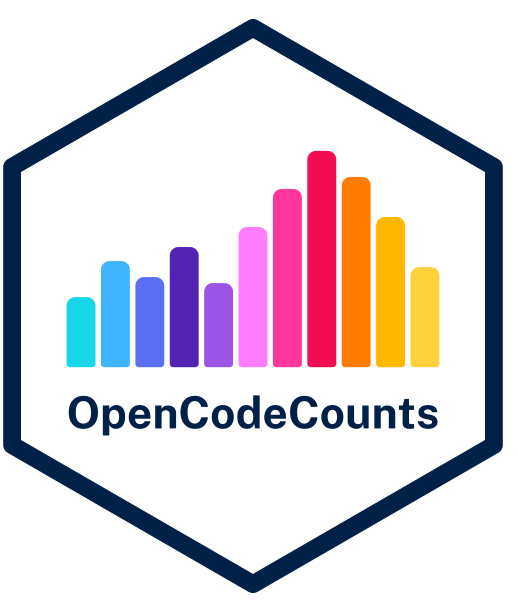

<!-- README.md is generated from README.Rmd. Please edit that file -->

# OpenCodeCounts <a href="https://bennettoxford.github.io/opencodecounts/"></a>

<!-- badges: start -->

[](https://github.com/bennettoxford/opencodecounts/actions/workflows/R-CMD-check.yaml)
<!-- badges: end -->

The `opencodecounts` R package provides easy access to yearly summaries
of clinical code usage in England. The package makes NHS England’s
published datasets available in R and an interactive online tool,
covering SNOMED CT codes in primary care and ICD-10/OPCS-4 codes in
secondary care.

You can launch the interactive Shiny app by clicking on [Launch Shiny
App](https://bennettoxford.github.io/opencodecounts/articles/app.html).
For work in R, all available functions are documented in the [Function
reference](https://bennettoxford.github.io/opencodecounts/reference/index.html)
section.

You can also check the SNOMED CT codelists of an OpenSAFELY study for
inactive codes and their replacements with recorded usage, in R or in
the terminal. See [How to check codelists for inactive SNOMED CT codes
with
usage](https://bennettoxford.github.io/opencodecounts/articles/check-codelists.html).

## Installation

You can install the `opencodecounts` package in R with:

``` r
# install.packages("pak")
pak::pak("bennettoxford/opencodecounts")
```

## How-to guides

- [How to use the Shiny
  app](https://bennettoxford.github.io/opencodecounts/articles/how-to-use-shiny-app.html)
- [How to use the R
  package](https://bennettoxford.github.io/opencodecounts/articles/how-to-use-R-pkg.html)
- [How to use ICD-10 and OPCS-4
  breakdowns](https://bennettoxford.github.io/opencodecounts/articles/how-to-use-breakdowns.html)
- [How to extract semantic tags from SNOMED CT
  descriptions](https://bennettoxford.github.io/opencodecounts/articles/extract-snomedct-sem-tag.html)
- [How to check codelists for inactive SNOMED CT codes with
  usage](https://bennettoxford.github.io/opencodecounts/articles/check-codelists.html)

## Available datasets

The table below lists every dataset in the `opencodecounts` R package,
with links to download the tidy data as Parquet files. GP data covers
2011-08-01 to 2026-07-31, and HES data covers 2012-04-01 to 2026-03-31.
Read the vignette for more on each dataset: [Available datasets in
opencodecounts](https://bennettoxford.github.io/opencodecounts/articles/available-datasets.html).

| Function | Description | Tidy data |
|:---|:---|:---|
| `get_gp_snomed()` | GP records, SNOMED CT (v0.2.0) | [Download](https://github.com/bennettoxford/opencodecounts/releases/download/gp-snomed-v0.2.0/gp_snomed.parquet) |
| `get_hesapc_icd10()` | HES Admitted Patient Care, ICD-10 diagnoses (v0.2.0) | [Download](https://github.com/bennettoxford/opencodecounts/releases/download/hesapc-icd10-v0.2.0/hesapc_icd10.parquet) |
| `get_hesapc_icd10_breakdowns()` | HES Admitted Patient Care, ICD-10 diagnoses, with breakdowns (v0.2.0) | [Download](https://github.com/bennettoxford/opencodecounts/releases/download/hesapc-icd10-breakdowns-v0.2.0/hesapc_icd10_breakdowns.parquet) |
| `get_hesapc_opcs4()` | HES Admitted Patient Care, OPCS-4 procedures (v0.2.0) | [Download](https://github.com/bennettoxford/opencodecounts/releases/download/hesapc-opcs4-v0.2.0/hesapc_opcs4.parquet) |
| `get_hesapc_opcs4_breakdowns()` | HES Admitted Patient Care, OPCS-4 procedures, with breakdowns (v0.2.0) | [Download](https://github.com/bennettoxford/opencodecounts/releases/download/hesapc-opcs4-breakdowns-v0.2.0/hesapc_opcs4_breakdowns.parquet) |

## For developers

See [DEVELOPERS.md](DEVELOPERS.md).

## Licence

### R package

The `opencodecounts` package is licensed under the [MIT
License](LICENSE.md).

### Code usage datasets

All code usage datasets are Copyright NHS England and licensed under the
[Open Government Licence
v3.0](https://www.nationalarchives.gov.uk/doc/open-government-licence/version/3/).
Contains public sector information licensed under the Open Government
Licence v3.0.
